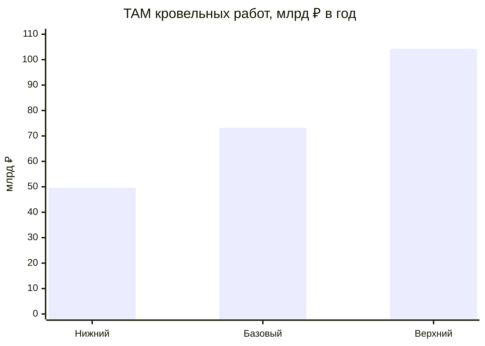
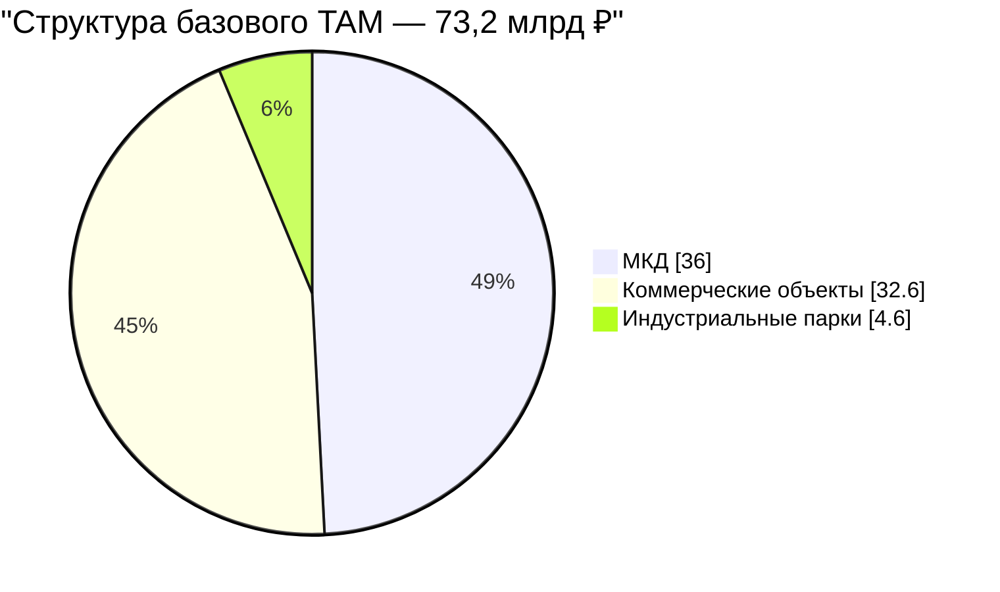

# Вирка.РФ — инвестиционный обзор и модель рынка России

**Версия 1.0 | 13 ноября 2026 года**  
ООО «Балтийская кровельная компания»  
**Статус:** инвестиционный рабочий документ. Рыночные оценки и финансовые прогнозы сценарные, требуют подтверждения пилотами и фактическими контрактами.

## 1. Проект в одном абзаце

«Вирка.РФ» — разрабатываемая роботизированная платформа для обследования, ремонта и обслуживания кровель. Проект нацелен на многоквартирные дома, коммерческие здания, склады и промышленные объекты. Предполагаемая монетизация включает продажу роботов, аренду с сервисным сопровождением (RaaS), кровельные работы, диагностику, мониторинг, ПО и технологии повторного использования материалов.

## 2. Главный рыночный вывод

**Базовый ориентир ежегодного рынка кровельных работ — 73,2 млрд ₽. Расчётный диапазон — 49,6–104,3 млрд ₽.**

Это сценарная bottom-up оценка трёх сегментов, а не опубликованная государством единая цифра и не сплошной подсчёт контрактов.

| Сегмент | Нижний | Базовый | Верхний |
|---|---:|---:|---:|
| МКД — только расчётная кровельная часть капремонта | 27,0 | 36,0 | 45,0 |
| Коммерческие кровли | 19,8 | 32,6 | 51,9 |
| Производственные помещения индустриальных парков | 2,8 | 4,6 | 7,4 |
| **Всего, млрд ₽/год** | **49,6** | **73,2** | **104,3** |

## 3. Как рассчитан рынок

### МКД

Стратегия развития строительной отрасли и ЖКХ РФ (распоряжение Правительства РФ №3268-р) содержит ориентир более 180 млрд ₽ ежегодно на весь капитальный ремонт МКД. Это крыши, фасады, инженерные системы, лифты и другие работы, а не только кровли.

В модели выделена предполагаемая доля кровельных работ 15–25%:
- нижний сценарий: 180 × 15% = 27 млрд ₽;
- базовый: 180 × 20% = 36 млрд ₽;
- верхний: 180 × 25% = 45 млрд ₽.

Доля 15–25% — модельное допущение, а не официальная структура расходов. Исторический ориентир 150 млрд ₽ также относится ко всему капремонту МКД; он сохранён в архиве и не прибавляется к 180 млрд ₽. Санкт-Петербург сообщал о 6,088 млрд ₽ на капремонт крыш в 2025 году — это контрольный пример отдельного регионального бюджета, не экстраполяция на страну.

### Коммерческая недвижимость

IBC Real Estate оценивала качественный коммерческий фонд России в I полугодии 2026 года примерно в 148,3 млн м²: склады 80,35 млн м², офисы 31,3 млн м², торговые объекты 27,1 млн м², гостиницы и прочие объекты около 9,55 млн м².

Расчёт: площадь фонда × стоимость ремонта 1 м² ÷ цикл ремонта.

| Сценарий | Ставка | Цикл | Годовой рынок |
|---|---:|---:|---:|
| Нижний | 4 000 ₽/м² | 30 лет | 19,8 млрд ₽ |
| Базовый | 5 500 ₽/м² | 25 лет | 32,6 млрд ₽ |
| Верхний | 7 000 ₽/м² | 20 лет | 51,9 млрд ₽ |

Площадь коммерческого фонда — proxy площади кровель. Фактическая площадь крыши может отличаться от площади здания; не каждый объект имеет плоскую кровлю или технически подходит под роботизацию. Это ключевая неопределённость модели.

### Промышленность

Росстат фиксировал ввод около 6,6 млн м² промышленных зданий в 2024 году и около 6,8 млн м² в 2025 году. Это годовой ввод, не весь действующий фонд.

Для ограниченной измеримой базы использована оценка около 21 млн м² производственных помещений действующих индустриальных парков (обзор Ассоциации индустриальных парков России за 2025 год). При тех же сценарных ставках и циклах получается 2,8–7,4 млрд ₽ в год, базово около 4,6 млрд ₽.

Это не весь промышленный рынок. Оценка NF Group 45,7 млн м² индустриальной недвижимости за 2023 год шире и может пересекаться со складским сегментом; поэтому она не прибавляется к 21 млн м².

## 4. Что включено и что не включено

В TAM включены расчётные кровельные работы в МКД, коммерческой недвижимости и производственных помещениях индустриальных парков.

Не включены:
- весь бюджет капремонта МКД целиком;
- весь промышленный фонд страны;
- рынок кровельных материалов;
- продажа роботов и робототехнического оборудования;
- RaaS, ПО, мониторинг и диагностика как отдельные рынки.

Такое разделение предотвращает двойной счёт и не смешивает подрядный рынок кровель с рынком оборудования и услуг.

## 5. Цель компании — 1 млрд ₽ годовой выручки

Отношение целевой выручки к расчётному TAM:

| База | Доля 1 млрд ₽ |
|---|---:|
| Нижний TAM 49,6 млрд ₽ | 2,02% |
| Базовый TAM 73,2 млрд ₽ | 1,37% |
| Верхний TAM 104,3 млрд ₽ | 0,96% |

Это иллюстрация масштаба цели, а не прогноз фактического захвата рынка. Часть выручки будет приходиться на продажу оборудования и сервисы, для которых необходимы отдельные модели рынка и мощности.

## 6. Финансовый план достижения 1 млрд ₽

### Инвестиционный раунд

Базовая потребность — **100 млн ₽**, диапазон — **80–150 млн ₽**.

| Направление | млн ₽ | Доля |
|---|---:|---:|
| НИОКР, проектирование, прототип | 38 | 38% |
| Испытания и сертификация | 15 | 15% |
| Пилоты | 12 | 12% |
| Команда на 18–24 месяца | 20 | 20% |
| Подготовка производства | 8 | 8% |
| Патентование и защита ИС | 4 | 4% |
| Маркетинг, продажи, резерв | 3 | 3% |
| **Всего** | **100** | **100%** |

### План выручки

Млн ₽, без НДС; целевой сценарий.

| Год | Продажи комплексов | RaaS | Работы, сервис, диагностика и ПО | Всего |
|---|---:|---:|---:|---:|
| 2027 | 0 | 0 | 0 | **0** |
| 2028 | 60 | 12 | 5 | **77** |
| 2029 | 180 | 48 | 22 | **250** |
| 2030 | 375 | 120 | 55 | **550** |
| 2031 | 600 | 210 | 190 | **1 000** |

В 2031 году базовый план предполагает:
- 40 проданных комплексов по средней цене 15 млн ₽ = 600 млн ₽;
- 210 млн ₽ RaaS, эквивалент 35 комплексо-лет по 500 тыс. ₽ в месяц при полной оплачиваемой загрузке;
- 190 млн ₽ работ, сервиса, диагностики и ПО.

Это требует расширения производства, сервисной сети, операторов, запасных частей и каналов продаж. Проданные клиентам комплексы не считаются автоматически частью собственного RaaS-парка.

### Укрупнённый P&L

Млн ₽, предварительный сценарий.

| Показатель | 2028 | 2029 | 2030 | 2031 |
|---|---:|---:|---:|---:|
| Выручка | 77 | 250 | 550 | 1 000 |
| Себестоимость | 44 | 140 | 243,5 | 549,5 |
| Валовая прибыль | 33 | 110 | 306,5 | 450,5 |
| Операционные расходы | 45 | 75 | 125 | 160 |
| **EBITDA** | **−12** | **35** | **181,5** | **290,5** |

Не включены проценты, налоги, амортизация, капзатраты на расширение и изменение оборотного капитала. Для инвестиционного решения необходима полная модель денежных потоков.

## 7. Контрольные этапы и метрики

1. Проектирование и лабораторный прототип.
2. Испытания на реальных типах кровель.
3. Проверка безопасности, качества и производительности.
4. 3–5 пилотных внедрений при наличии площадок и договорённостей.
5. Первые платные контракты и подтверждение unit economics.
6. Серийное производство, сервисная сеть и масштабирование.

На пилотах измерять: м² за смену; себестоимость м²; долю автоматизированных операций; техническую готовность; простой; долю переделок; численность персонала; экономию относительно традиционного метода; срок окупаемости для клиента.

## 8. Риски и оговорки

Рыночные цифры чувствительны к доле кровель в капремонте МКД, фактической площади кровель, циклу ремонта и объёму действующего промышленного фонда. Финансовая цель зависит от успешного прототипа, подтверждённого ROI, доступности финансирования и способности производить и обслуживать нужное количество комплексов.

**Итог:** проект рассматривает большой, фрагментированный рынок с предварительным базовым TAM около 73 млрд ₽/год. Цель 1 млрд ₽ годовой выручки к 2031 году является амбициозным плановым сценарием, а не гарантией.

## 9. Документы и история расчётов

- Подробная методика и источники: [Исследование рынка России](Market_Research_Russia_2026.md).
- Сохранённые предварительные оценки и отвергнутые гипотезы: [Архив допущений](market-research/archive/Preliminary_Assumptions_2026-11.md).
- Подробная финансовая модель: [Financial_Model.md](Financial_Model.md).

## 10. Основные источники

- Стратегия развития строительной отрасли и ЖКХ РФ, распоряжение №3268-р: https://rags.ru/documents/dop_documents/71/sp_650/0/raspo.html
- IBC Real Estate: https://data.ibcrealestate.ru/open/
- Ассоциация индустриальных парков России, обзор 2025: https://indparks.ru/materials/edition/obzor-industrialnykh-parkov-rossii-2025/
- NF Group: https://fs.moex.com/f/20682/prezentacija-rental-pro.pdf
- Росстат: https://rosstat.gov.ru/folder/14458
- Санкт-Петербург: https://www.gov.spb.ru/press/governor/312806/
