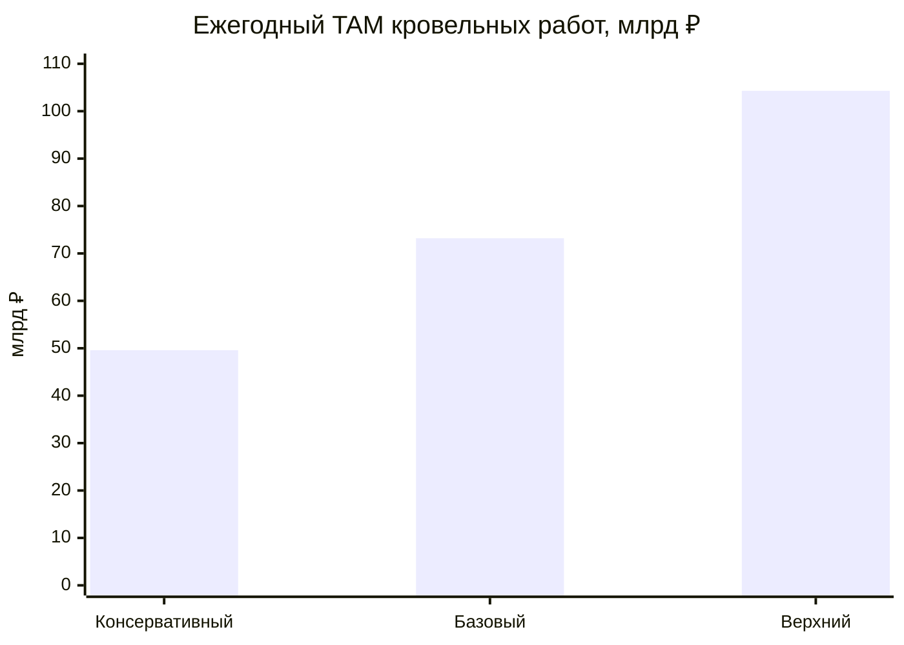
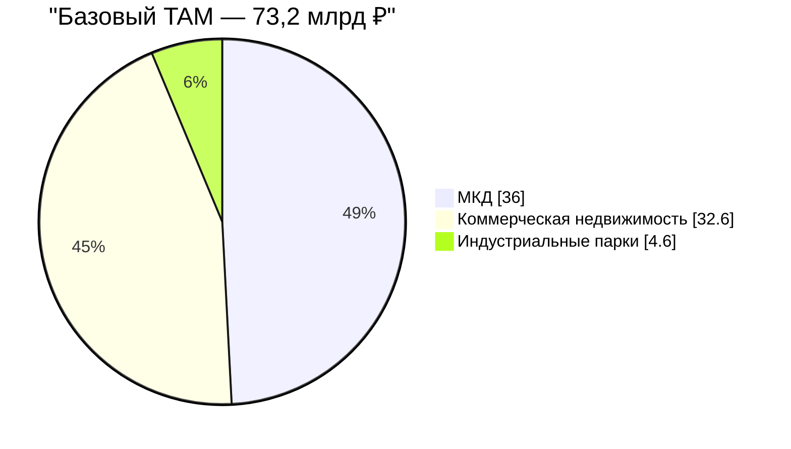

# Вирка.РФ — инвестиционная оценка рынка России

**Версия 1.0 | 13 ноября 2026 года**  
**Статус:** сценарная bottom-up модель, не единая официальная статистическая оценка.

## 1. Итог для инвестора

**Базовый ориентир ежегодного TAM: 73,2 млрд ₽. Расчётный диапазон: 49,6–104,3 млрд ₽.**

Оценка охватывает кровельные работы в трёх сегментах: МКД, качественная коммерческая недвижимость и производственные помещения действующих индустриальных парков.

| Сегмент | Консервативный | Базовый | Верхний |
|---|---:|---:|---:|
| МКД — кровельная часть капремонта | 27,0 | 36,0 | 45,0 |
| Коммерческие кровли | 19,8 | 32,6 | 51,9 |
| Производственные помещения индустриальных парков | 2,8 | 4,6 | 7,4 |
| **Итого, млрд ₽/год** | **49,6** | **73,2** | **104,3** |

Это не опубликованная государством цифра и не сплошной подсчёт контрактов. Это прозрачная модель, основанная на доступных данных о площадях и бюджетных ориентирах плюс явно обозначенные допущения. Она пригодна как предварительная инвестиционная гипотеза, но требует верификации фактическими закупками и площадями кровель.

## 2. Графики

## 3. Методика расчёта

### 3.1. МКД

Стратегия развития строительной отрасли и ЖКХ РФ (распоряжение Правительства РФ №3268-р) указывает ежегодный объём капитального ремонта более 180 млрд ₽. Это все работы по общему имуществу МКД: крыши, фасады, инженерные системы, лифты и другое.

Для предварительного выделения кровельной части применено допущение 15–25% от 180 млрд ₽. Это модельная доля, не официальная статистика.

| Сценарий | Доля кровель | Расчёт | Рынок |
|---|---:|---:|---:|
| Консервативный | 15% | 180 × 15% | 27 млрд ₽ |
| Базовый | 20% | 180 × 20% | 36 млрд ₽ |
| Верхний | 25% | 180 × 25% | 45 млрд ₽ |

Ранее использовавшиеся 150 млрд ₽ — исторический ориентир всего капремонта МКД, а не только крыш. Он не прибавляется к 180 млрд ₽: это альтернативные/разновременные ориентиры одного смежного рынка.

Контрольный пример: Санкт-Петербург сообщал о 6,088 млрд ₽, предусмотренных на капитальный ремонт крыш в 2025 году. Это отдельный бюджет одного региона, не основание для механической экстраполяции на всю страну.

### 3.2. Коммерческая недвижимость

По данным IBC Real Estate, качественный коммерческий фонд России в I полугодии 2026 года — около 148,3 млн м².

| Сегмент | Площадь |
|---|---:|
| Склады и логистика | 80,35 млн м² |
| Офисы | 31,3 млн м² |
| Торговая недвижимость | 27,1 млн м² |
| Гостиницы и прочие объекты | около 9,55 млн м² |
| **Всего** | **148,3 млн м²** |

Формула: годовой рынок = площадь фонда × стоимость ремонта 1 м² ÷ цикл ремонта.

| Сценарий | Стоимость ремонта | Цикл | Годовой рынок |
|---|---:|---:|---:|
| Консервативный | 4 000 ₽/м² | 30 лет | 19,8 млрд ₽ |
| Базовый | 5 500 ₽/м² | 25 лет | 32,6 млрд ₽ |
| Верхний | 7 000 ₽/м² | 20 лет | 51,9 млрд ₽ |

Площадь коммерческого фонда используется как proxy площади кровель. Фактическая площадь крыш может отличаться от площади зданий; не все объекты имеют плоскую кровлю или подходят под технологию. Требуется уточнение по типам зданий, этажности, конструкциям и технической доступности.

### 3.3. Промышленность

Годовой ввод промышленных зданий нельзя считать действующим фондом. По данным Росстата, ежегодный ввод составлял около 6,6 млн м² в 2024 году и около 6,8 млн м² в 2025 году — это поток нового строительства, а не накопленная площадь.

Для ограниченной измеримой базы использована оценка около 21 млн м² производственных помещений на действующих площадках индустриальных парков (обзор Ассоциации индустриальных парков России за 2025 год).

| Сценарий | Ставка | Цикл | Рынок в год |
|---|---:|---:|---:|
| Консервативный | 4 000 ₽/м² | 30 лет | 2,8 млрд ₽ |
| Базовый | 5 500 ₽/м² | 25 лет | 4,6 млрд ₽ |
| Верхний | 7 000 ₽/м² | 20 лет | 7,35 млрд ₽ |

Это не весь промышленный фонд России, а proxy производственных помещений индустриальных парков. NF Group оценивала индустриальную недвижимость в 45,7 млн м² в 2023 году, но категория шире и может включать складские форматы, пересекающиеся с коммерческим сегментом. Поэтому 45,7 млн м² не прибавляются к 21 млн м².

## 4. TAM, SAM и SOM

- **TAM:** 49,6–104,3 млрд ₽/год; базовый ориентир 73,2 млрд ₽/год в пределах охваченных сегментов и принятых допущений.
- **SAM:** часть TAM, доступная конкретной версии робота с учётом типа кровли, уклона, несущей способности, геометрии, покрытия, доступа, погоды, норм безопасности и производительности. Численный SAM пока не фиксируется до утверждения технической спецификации.
- **SOM:** реально достижимая доля с учётом парка роботов, пропускной способности, сервисной сети, операторов, географии и подтверждённых каналов продаж. Нельзя назначать произвольный процент от TAM.

## 5. Цель — 1 млрд ₽ выручки

| Сопоставление | Доля |
|---|---:|
| 1 млрд ₽ от нижней оценки 49,6 млрд ₽ | 2,02% |
| 1 млрд ₽ от базовой оценки 73,2 млрд ₽ | 1,37% |
| 1 млрд ₽ от верхней оценки 104,3 млрд ₽ | 0,96% |

Это только сопоставление масштаба цели с TAM, а не прогноз захвата рынка. Продажа роботов, RaaS, ПО и диагностика являются отдельными потоками и требуют самостоятельной рыночной оценки.

## 6. Дополнительные рынки вне кровельного TAM

Обследование и диагностика; цифровой мониторинг; профилактическое обслуживание; аренда роботов (RaaS); продажа комплексов; ПО и аналитика; повторное использование рубероида и других материалов. Эти направления не прибавлены к 73,2 млрд ₽, чтобы не смешивать рынок подрядных кровельных работ с рынками оборудования и услуг.

## 7. Ограничения и чувствительность

Наиболее значимые допущения: доля кровель в капремонте МКД; площадь реальных кровель коммерческих зданий; цикл ремонта по типам покрытий; цена работ за м²; размер действующего промышленного фонда; техническая доступность объектов для робота.

Поэтому 73,2 млрд ₽ — **рабочая инвестиционная оценка**, а не подтверждённый фактический оборот рынка.

## 8. План верификации

1. Агрегировать региональные программы капремонта МКД и строки «ремонт крыши».
2. Очистить закупки ЕИС по ОКПД2 43.91 от дублей, текущего ремонта, лимитных и несопоставимых лотов.
3. Сформировать выборку коммерческих объектов с фактической площадью кровель.
4. Получить более полный реестр промышленных зданий и устранить пересечение со складским фондом.
5. Проверить стоимость и цикл ремонта по реальным контрактам.
6. После утверждения технической спецификации рассчитать SAM.
7. Построить SOM по производительности и числу комплексов.

## 9. Источники

- Правительство РФ, Стратегия развития строительной отрасли и ЖКХ РФ, распоряжение №3268-р: https://rags.ru/documents/dop_documents/71/sp_650/0/raspo.html
- IBC Real Estate: https://data.ibcrealestate.ru/open/
- Ассоциация индустриальных парков России, обзор 2025 года: https://indparks.ru/materials/edition/obzor-industrialnykh-parkov-rossii-2025/
- NF Group: https://fs.moex.com/f/20682/prezentacija-rental-pro.pdf
- Росстат, строительство: https://rosstat.gov.ru/folder/14458
- Росстат, основные фонды: https://rosstat.gov.ru/folder/14304
- Санкт-Петербург, сведения о капремонте: https://www.gov.spb.ru/press/governor/312806/

## 10. История оценки

Ранние ориентиры 150 млрд ₽ и 180+ млрд ₽ относились ко всему капитальному ремонту МКД. Первоначальная оценка коммерческого сегмента 19,8–51,9 млрд ₽ сохранена в текущей модели. Предыдущие гипотезы и причины уточнений зафиксированы в архиве: [Preliminary_Assumptions_2026-11.md](market-research/archive/Preliminary_Assumptions_2026-11.md).

**Формулировка для презентации:** «Предварительная bottom-up оценка ежегодного российского рынка кровельных работ в сегментах МКД, коммерческой недвижимости и производственных помещений индустриальных парков составляет около 73 млрд ₽, с расчётным диапазоном 50–104 млрд ₽. Оценка сценарная; проект продолжает верификацию по региональным программам, контрактам и площадям объектов».
